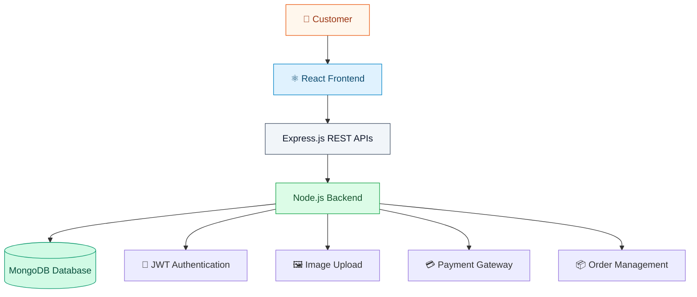

# 🛍️ SHOPORA — Full Stack E-Commerce Application

<h3 align="center">Your Shopping World, Just One Click Away.</h3>

<p align="center">
  A modern full-stack online shopping platform built with React, Node.js, Express.js and MongoDB.
</p>

<p align="center">
  
  
  
  
  
</p>

<p align="center">
  <a href="#-about-the-project">About</a> •
  <a href="#-shopping-experience">Experience</a> •
  <a href="#-features">Features</a> •
  <a href="#-architecture">Architecture</a> •
  <a href="#-get-started">Get Started</a>
</p>

---

## 🏬 ABOUT THE PROJECT

Welcome to **SHOPORA**, a full-stack E-Commerce web application designed to provide a seamless and convenient online shopping experience.

From discovering products to placing orders, SHOPORA brings essential shopping functionalities together in one platform.

The application allows customers to explore products, view detailed descriptions, check ratings, manage their shopping carts, securely authenticate their accounts and complete purchases through payment integration.

<table>
<tr>
<td align="center" width="25%">
<h2>🛒</h2>
<b>Easy Shopping</b>
<br/>
<sub>Browse products effortlessly</sub>
</td>
<td align="center" width="25%">
<h2>🔐</h2>
<b>Secure Access</b>
<br/>
<sub>User authentication</sub>
</td>
<td align="center" width="25%">
<h2>💳</h2>
<b>Easy Payments</b>
<br/>
<sub>Integrated checkout</sub>
</td>
<td align="center" width="25%">
<h2>📦</h2>
<b>Order Management</b>
<br/>
<sub>Place and manage orders</sub>
</td>
</tr>
</table>

---

## 🛍️ THE SHOPPING EXPERIENCE

<p align="center">
  <b>Discover → Explore → Add to Cart → Checkout → Order</b>
</p>

| Shopping Stage | What Happens? |
|:---|:---|
| 🏠 Discover | Explore the home page and available products |
| 🔍 Explore | View product descriptions, images and ratings |
| 🛒 Add to Cart | Select products and manage cart items |
| 👤 Sign In | Register or log in to your account |
| 💳 Checkout | Proceed through the payment process |
| 📦 Order | Complete the order placement process |

---

## ✨ WHAT MAKES IT SPECIAL?

### 🏠 Explore the Store
- Attractive home page with product listings.
- Easy product browsing.
- Individual product detail pages.
- Product images and descriptions.

### ⭐ Product Discovery
- Product ratings and customer reviews.
- Detailed product information.
- Image upload support.

### 🛒 Smart Shopping Cart
- Add products to the shopping cart.
- Manage selected items.
- Review products before checkout.

### 👤 User Account Management
- User registration.
- Secure login.
- JWT-based authentication.
- Protected user access.

### 💳 Checkout & Payments
- Payment integration.
- Order placement functionality.
- Convenient checkout experience.

### 📱 Responsive Experience
- Responsive user interface.
- Bootstrap and CSS styling.
- Compatible with different screen sizes.

---

## 🎨 APPLICATION PREVIEW

<p align="center">
  <b>A glimpse of the SHOPORA shopping experience</b>
</p>

<p align="center">
  
</p>

<table>
<tr>
<td width="50%" align="center">

**🏠 Home & Products**


</td>
<td width="50%" align="center">

**🛍️ Shopping Cart**


</td>
</tr>
<tr>
<td width="50%" align="center">

**🔐 Login & Registration**


</td>
<td width="50%" align="center">

**💳 Checkout & Orders**


</td>
</tr>
</table>

<sub>Note: These are illustrative placeholders. Replace them with actual screenshots of your running application.</sub>

---

## 🧩 TECHNOLOGY BEHIND THE STORE

<table>
<tr>
<th>Layer</th>
<th>Technology</th>
<th>Purpose</th>
</tr>
<tr>
<td>🎨 Frontend</td>
<td>React.js</td>
<td>Interactive user interface</td>
</tr>
<tr>
<td>💅 Styling</td>
<td>Bootstrap, CSS</td>
<td>Responsive design</td>
</tr>
<tr>
<td>⚙️ Backend</td>
<td>Node.js</td>
<td>Server-side execution</td>
</tr>
<tr>
<td>🔗 API</td>
<td>Express.js</td>
<td>Backend routing and APIs</td>
</tr>
<tr>
<td>🗄️ Database</td>
<td>MongoDB</td>
<td>Data storage</td>
</tr>
<tr>
<td>🔐 Security</td>
<td>JWT</td>
<td>User authentication</td>
</tr>
</table>

---

## 🏗️ APPLICATION ARCHITECTURE



---

## 📂 PROJECT STRUCTURE

```text
E-Commerce-App/
│
├── backend/
│   ├── config/
│   ├── controllers/
│   ├── models/
│   ├── routes/
│   ├── middleware/
│   └── server.js
│
├── frontend/
│   ├── public/
│   ├── src/
│   │   ├── components/
│   │   ├── pages/
│   │   ├── assets/
│   │   └── App.js
│   └── package.json
│
├── uploads/
│
├── .env.example
├── package.json
└── README.md
```

<sub>Illustrative structure — adjust the folder names to match your actual repository.</sub>

---

## ⚡ GET STARTED

<details>
<summary><b>01 | 📥 Download the Project</b></summary>

```bash
git clone https://github.com/your-username/E-Commerce-App.git
cd E-Commerce-App
```

</details>

<details>
<summary><b>02 | 📦 Install Backend Dependencies</b></summary>

```bash
npm install
```

</details>

<details>
<summary><b>03 | ⚛️ Install Frontend Dependencies</b></summary>

```bash
cd frontend
npm install
cd ..
```

</details>

<details>
<summary><b>04 | 🔑 Configure Environment Variables</b></summary>

Create a `.env` file in the root directory.

```env
PORT=5000
MONGO_URI=your_mongodb_connection
JWT_SECRET=your_secret_key
PAYMENT_API_KEY=your_payment_key
```

**Important:** Never upload your actual `.env` file or private API credentials to GitHub.

</details>

<details>
<summary><b>05 | 🚀 Start the Application</b></summary>

Run the command configured in your root `package.json`:

```bash
npm run dev
```

If your project uses separate frontend and backend commands, start both in separate terminals.

</details>

---

## 🔐 SECURITY & AUTHENTICATION

| Security Feature | Implementation |
|:---|:---|
| User Registration | Account creation |
| User Login | Authentication |
| JWT | Token-based authentication |
| Protected Routes | Restricted user access |
| Environment Variables | Sensitive configuration management |

---

## 💳 PAYMENT & ORDER PROCESSING

The application includes a payment integration and order placement workflow.

**Purchase Journey:**

```text
Product Selection
       ↓
Shopping Cart
       ↓
Checkout
       ↓
Payment Processing
       ↓
Order Placement
       ↓
Order Confirmation
```

<sub>Configure the actual payment provider and credentials according to your implementation.</sub>

---

## 🌱 POSSIBLE FUTURE UPGRADES

| Enhancement | Benefit |
|:---|:---|
| ❤️ Wishlist | Save favourite products |
| 🔔 Order Notifications | Keep customers informed |
| 🔎 Advanced Search | Find products quickly |
| 🎯 Product Recommendations | Personalized shopping |
| 📊 Admin Dashboard | Monitor sales and products |
| 🚚 Order Tracking | Track delivery progress |
| 🏷️ Discount Coupons | Offer promotional discounts |

---

## 🤝 CONTRIBUTION CORNER

Want to improve SHOPORA?

1. Fork the repository.
2. Create a new feature branch.
3. Implement your changes.
4. Commit and push your work.
5. Submit a Pull Request.

Contributions, suggestions and improvements are welcome!

---

## 📜 LICENSE

This project is available under the MIT License.

---

## 👩‍💻 MEET THE DEVELOPER

<p align="center">
  
</p>

<p align="center">
  <b>Building Digital Experiences, One Project at a Time.</b>
</p>

<p align="center">
  ⭐ If you like this project, show your support by starring the repository!
</p>

<p align="center">
  <i>SHOPORA — Shop Smart. Shop Simple. Shop Online. 🛒</i>
</p>
